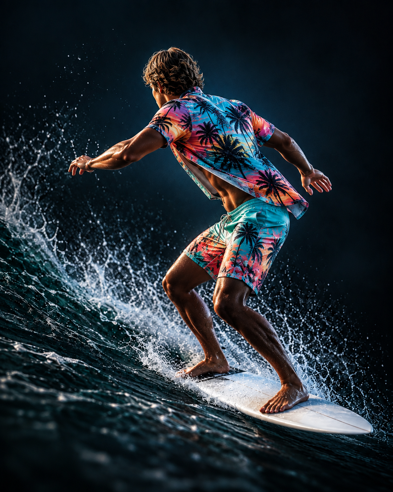
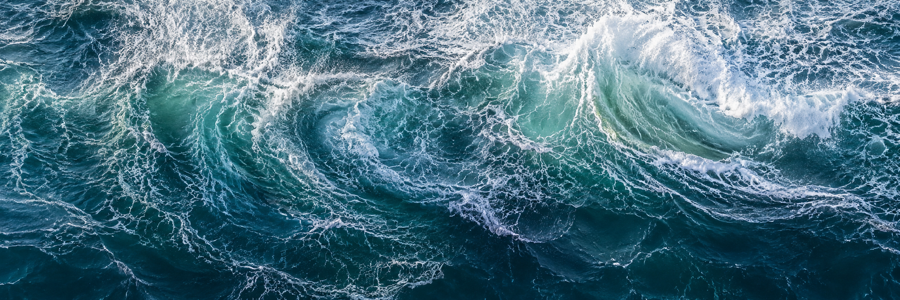

## Background: Music Visualization and ZGameEditor Visualizer

Since getting back into music production, I've been exploring how to share my tracks. YouTube is one option I've been spending time with. Its potential audience is substantial: DataReportal's 2026 update reports that YouTube ads reach 2.65 billion users each month. That is an advertising-reach estimate, not a count of unique monthly active users. [Source: DataReportal](https://datareportal.com/social-media-users).

A static image is enough to put a song on YouTube, but I wanted the visuals to participate in the listening experience. Music visualization gives sound a visible response. For this project, that meant an image changing with the music instead of staying fixed throughout the track.

ZGameEditor Visualizer is a visual effects plugin in FL Studio that can render its output as a video. It combines layers of imagery and effects, some of which respond to audio. [Source: Image-Line manual](https://www.image-line.com/fl-studio-learning/fl-studio-online-manual/html/plugins/ZGameEditor%20Visualizer.htm).

You don't need to use FL Studio to follow the idea behind this project. The useful question is what a visual can add to your song. Here is how I approached that question with a surfer and a moving wave.

## Imagining a Surfer Inside the Music

For my new track ["Shake Out!"](https://www.youtube.com/watch?v=qN4D0hA4fE4), I imagined a surfer in the middle of the screen, riding in front of large waves. The song made me think of water, probably because of the heavy use of noise throughout it. I wanted to turn that association into something visible.

You can also listen to ["Shake Out!" on SoundCloud](https://soundcloud.com/tarcan-gul/shake-out).

The scene needed a moving background, with the surfer responding to the track in front of it. I used Youlean Tunnel with a water image for the background and Peakmap for the surfer. Together, they gave me a way to connect the imagined scene to the sound.

I think of this as music-reactive rather than interactive: the song drives the image, not the viewer. That distinction matters because the visual is part of the arrangement's presentation. When the music becomes calmer, the image can feel different without asking the listener to do anything.

## Making the Surfer React with Peakmap

I started by loading this PNG into Peakmap as its image source:

In my setup, Peakmap's **Audio Source** is **Master**, and its **Data Mode** is **Spectral**. In plain language, I wanted the image to respond to the song's frequency content. The desired reaction happened immediately after loading the surfer into this setup.

The clearest difference is between a passage with the kick and a calm passage without beat or bass. When the kick appears, the blue areas across the surfer and board become fuller and more prominent. In the calm passage, the figure looks less filled in, and more of the water behind it shows through.

That contrast is what made the effect work for me. The surfer remains the subject, but its presence changes with the music. It feels connected to the track instead of being a picture placed over an unrelated animation.

Although the kick makes the change easy to notice, my input is the Master signal, not an isolated kick track. I wouldn't describe this as a dedicated kick detector. These are observations from my song and settings, rather than a promise that another track will produce exactly the same result.

If you're trying a similar idea, compare a busy passage with a quieter one before judging the result. A visual that looks good during the beat should also make sense when that beat disappears. For my scene, the less prominent surfer during the calm section was part of the appeal.

## Bringing the Scene Together with a Wave, Mask, and Buffer

For the moving background, I used this water texture with Youlean Tunnel:

The background supplied the ongoing wave behind the surfer. Peakmap supplied the musical response in the foreground. Keeping those jobs separate helped me think about the scene: the water established the setting, while the surfer made the changes in the music visible.

There was a problem to work around. After adding Peakmap, unwanted straight lines appeared on the right side. I used Youlean Mask and a buffer to deal with them, then brought the result back through Youlean From Buffer. This was a workaround for my composition, not a diagnosis of a general Peakmap bug.

Here is the mask image for this post:

The layers in my patch run from left to right in this order. The letters are their labels in my setup, not an alphabetical processing order.

| Layer | Effect | Role or setting in my patch |
| --- | --- | --- |
| C | Peakmap | Surfer image, Master audio source, Spectral mode |
| D | Youlean Mask | Masked foreground, with To Buffer enabled |
| A | Youlean Tunnel | Moving background using the water texture |
| F | Raindrops | Additional effect for the scene |
| E | Youlean From Buffer | Image source set to Output from layer D |
| B | TextTrueType | Final text layer |

Why does the foreground appear first? ZGameEditor Visualizer normally builds its composition from left to right, but **To Buffer** stores the accumulated image and lets the next layer start with a clean image. A later layer can use that stored result as its image source. [Source: Image-Line manual](https://www.image-line.com/fl-studio-learning/fl-studio-online-manual/html/plugins/ZGameEditor%20Visualizer.htm).

In this patch, the buffered result is the masked surfer. Youlean Tunnel follows it, and Youlean From Buffer later brings the foreground back into the composition. My Youlean From Buffer layer points to the output of layer D, with **Ignore Black** enabled. That explains how the surfer can sit in front of the wave even though Peakmap appears earlier in the layer order.

I also added Raindrops for extra visual texture. The main idea still rests on the relationship between the surfer and the song. More effects aren't the goal; a response that fits the music is.

For me, creating supplementary art is a way to deepen engagement with the main artwork: the song. The water came from an association I already heard in "Shake Out!", and Peakmap let that association respond to the music. That's what I want to carry into future visualizations: a visual idea that grows out of the track and gives the listener another reason to stay with it.

## References

- [My music video](https://www.youtube.com/watch?v=qN4D0hA4fE4)
- ["Shake Out!" on SoundCloud](https://soundcloud.com/tarcan-gul/shake-out)
- [Image-Line: ZGameEditor Visualizer manual](https://www.image-line.com/fl-studio-learning/fl-studio-online-manual/html/plugins/ZGameEditor%20Visualizer.htm): plugin overview, layer order, and buffer behavior. Peakmap-specific observations come from my setup and examples.
- [DataReportal: Global social media statistics](https://datareportal.com/social-media-users): 2026 update reporting YouTube's monthly advertising reach of 2.65 billion. Accessed September 17, 2026.
